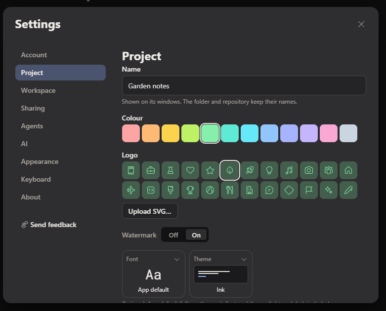
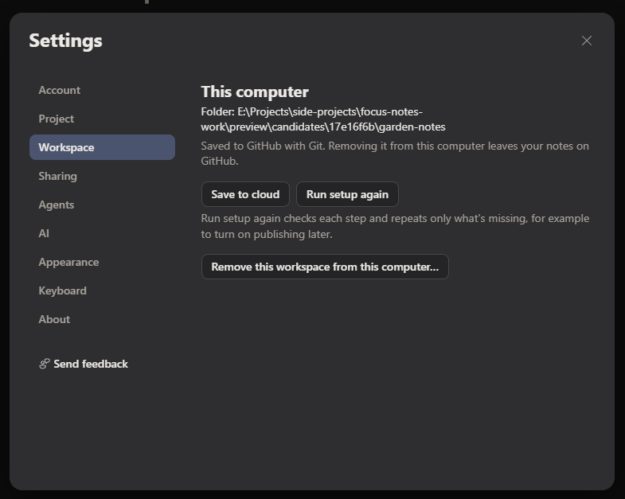

# One concept: Project

A project is the only place notes live together. "Workspace" leaves the app.

> [!NOTE]
> **TL;DR.** Project and workspace are one thing, so the app says **Project** everywhere and never "workspace". Every project is a folder whose history is kept with Git. A project is either **on this computer only** (local Git) or **linked to GitHub** (the same Git history, also on GitHub). The only thing outside a project is a **standalone file**: a compatible file opened once and edited in place, with no version history. Some file types, such as .txt, can't take images. Where images are allowed, they go in a folder beside the file. Settings loses its Workspace tab; the Project tab gains a "Where it's kept" section. **Approved by the owner on 5 November 2026:** "The project + Workspace design is approved. We can implement this design." Implementation changes user-facing words only; on-disk names stay until the owner decides. **Deleting a project** (also from GitHub) is a new strict design on top, waiting for the owner's approval (mocks `pnw.delete*`). Decision: D-pending in [Decisions](../plan/decisions.md#d-pending-project-replaces-workspace-everywhere).

## The owner's direction

The owner wrote, on 5 November 2026 (verbatim):

```text
Project and workspace are the same thing. Why have two separate concepts. It's confusing.
Everything unders workspace can be brought under Project.
Think this through critically from user mental model point of view and eliminate the term workspace completely from the app.
all projects have version control with git.
Projects can be completely offline or linked to a GitHub repo.
---
We do have the concept of opening and editing any file outside the conept of a project. This are just direct edit of compatible files as a one time standalone. We don't do version control, can't insert image on certain file types like txt.
Inserting image create a folder beside the file with the image file in it.
```

### What the live build shows today

The owner attached two screenshots of today's Settings.



**Project tab (today).** The project's identity: **Name** ("Shown on its windows. The folder and repository keep their names."), **Colour** (12 swatches), **Logo** (24 presets and **Upload SVG…**), **Watermark** (Off or On), and the **Font** and **Theme** tiles. Nothing here says where the project is kept.



**Workspace tab (today).** Where the same project is kept: the heading **This computer**, **Folder** with its path, "Saved to GitHub with Git…", **Save to cloud** and **Run setup again** with its note, and **Remove this workspace from this computer…**.

The two tabs describe one thing from two sides. A person who named and coloured "Garden notes" in Project has to know that "Workspace" is the same folder to find where it's saved or how to remove it.

## The mental model

**What people already believe.** People who write notes think in **things they work on**: a book, a job, a club. They don't think in containers that hold the things they work on. "Workspace" is a word from developer tools (VS Code, Slack). There it means the frame around the work, so it reads as a second, bigger thing that holds projects. Showing both words invites the wrong question: "is my project inside my workspace, or the other way round?" In Focus Notes they are the same folder, so the second word only adds doubt.

**The model the app teaches.**

| Thing | What it is | History | Images |
| --- | --- | --- | --- |
| **Project** | A folder of notes with its own window, name, colour and logo | Always kept with Git | In the project's `assets/` |
| ↳ on this computer only | Git history on this computer; nothing on GitHub | Local Git | As above |
| ↳ linked to GitHub | The same Git history, also on a GitHub repository; can be shared and opened on another computer | Git, pushed to GitHub | As above |
| **Standalone file** | One compatible file opened from anywhere, edited in place, one time | None | Only for types that can show them; in a folder beside the file |

**Rules this gives.**

- **One noun.** Project, in every window, menu, message, Help page and accessible name. "Workspace" is not a synonym, an alias or a heading.
- **Git is not a choice.** Making a project starts Git in its folder. Linking to GitHub is a later, optional step that adds a remote. It never changes what a project is.
- **Offline is a complete state.** A project on this computer only can be renamed, coloured, searched and given history like any other. Only sharing and opening it on another computer need GitHub. So **Link to GitHub…** is an offer, not a warning.
- **Where is chosen at creation** (owner, 7 November: “At no step in the creation process, it give me the option to create a local or GitHub (Cloud backed up) project.”). New project's step 2, **Where to keep it**, offers **On GitHub** and **On this computer only** as option cards; what Create project makes, and what the project's status shows afterwards, match that choice ([Projects → Creating and closing](projects.md#creating-and-closing)). Choosing this computer only is the same offline state as above, with **Link to GitHub…** later. The project's name is free text; on GitHub, its repository has its own GitHub-friendly name, made from it and editable (owner, 7 November 17:55, [Projects → The repository's own name](projects.md#the-repositorys-own-name)). Production creation now uses the signed-in account client, makes one private repository and pushes the first commit. A remote failure leaves local writing intact with explicit Continue setup, never silent local success or automatic creation retries; continuation state stays in the local Git config.
- **Standalone means "not in a project".** Its card says so plainly ("Not in a project · Edited in place. No version history."). The person learns from the absence what a project would add.
- **The file type decides what's possible.** A .txt file shows **Insert image…** disabled, with its reason ("Images need a Markdown file. Save as Markdown to add them.") and **Save as Markdown…** beside it. A Markdown file says where its images go before the first insert.

### Standalone file contract

PRJ-09 / UC-PROJ-08 and [G4](../plan/definition-of-done.md#g4-open-and-save-a-text-file-on-its-own) cover `.md`, `.markdown` and `.txt` through both Open file and Windows Open with. This closes the owner's explicit request to open a text file without importing it.

| Case | Required result |
| --- | --- |
| A file outside a project | Open one standalone window over that actual file; save in place. Never create Git, a project, a remote, an upload or project/share controls. Its local location signal never claims Backed up. |
| A file inside an open project | Route to that project's existing window, preserving its scope and the other windows' drafts. Do not open a second standalone copy. |
| Plain text | Save literal text back, with its supported encoding, BOM and line endings preserved. No front matter, Markdown serialization or implicit format conversion. Unsupported/unreadable encodings fail explicitly with the source unchanged. |
| Markdown-only features and images in .txt | Unavailable with the reason they require Markdown; no image asset or Markdown syntax written. Save as Markdown is explicit and creates a separate copy, preserving the source. Compatible Markdown images keep the existing asset convention until the separate owner decision in the reconciliation table. |
| Crash / external edit / disk failure | Dirty recovery survives restart. Compare external changes before replacement and show conflict choices; never silently overwrite. Keep text and a recovery action on a write/read failure. |
| Open/save takes over 100 ms | Existing local save/open feedback names the wait and its fn: measure; input remains usable and no remote task exists. |

The built journey opens a disposable .txt, edits, closes and reopens, asserts its exact saved bytes, then exercises external conflict and explicit conversion. It is not a proof that Markdown import happens to accept text.

## Reconciling the existing specs

These pages already say part of this. D-378 resolves the project/GitHub contradiction; the remaining proposals below stay explicitly separate decisions.

| # | Where | What it says now | Against the direction | Proposal |
| --- | --- | --- | --- | --- |
| 1 | [PRJ-01](../product/requirements.md#projects-prj), CP-SCOPE-01, SC-PROJ-01, UC-PROJ-01 | A project is a folder kept with Git, on this computer only or linked to a private GitHub repository the app creates for it | **Resolved by D-378**, applying the owner's 5 November direction | Explicit New project choice; local Git is complete, GitHub uses the signed-in account, no public site at setup. [G1 acceptance](../plan/definition-of-done.md#g1-new-project-on-this-computer-or-on-github). |
| 2 | [Projects → Local notes](projects.md#local-notes), DD-PROJ-04, UC-PROJ-07, SC-PROJ-04, CP-SCOPE-01 | Local notes are a third scope: no project, no Git | **Contradicts.** Standalone files are the only thing outside a project, and all projects have Git. | **Owner decision.** Recommended: Local notes becomes an ordinary project, **Local notes**, created on first use, on this computer only (local Git). Its quick-jot behaviour stays: one key and no project choice. Alternative: drop Local notes and let quick notes go to the last-used project. |
| 3 | Project creation and local-only status | Every project starts Git; offline means "no GitHub remote", not "no Git" | **Resolved in the spec by D-378**; production creation proof remains G1 | No remote means Saved on this computer, never Backed up. F1's status fix and F4's folder acceptance have landed; first real deletion remains owner-dependent (D-343). |
| 4 | [Images → Assets](images.md#assets-markdown-and-encrypted-sharing) | A standalone note's images go in `<full-note-filename>.assets/images/<id>.<ext>` | Partly: the owner says "a folder beside the file with the image file in it" (one folder, the image in it) | Flatten it to `<full-note-filename>.assets/<id>.<ext>`: one folder beside the file, images directly in it. Flagged for the owner, because it changes a built path. |
| 5 | [Images](images.md), .txt rule | .txt needs Save as Markdown before media | Agrees | Kept. The mock shows the disabled insert and its reason. |
| 6 | [Projects → Meeting Project](projects.md#meeting-project-for-the-first-time), Settings and words | "Settings: Project replaces Workspace" | Agrees, but the build still has a Workspace tab | The merged Project tab mocked below is that replacement. |

<h2 id="settings-project-merged">Settings → Project, merged</h2>

The Workspace tab goes. Its contents move to the end of the Project tab under **Where it's kept**, after the identity choices (name, colour, logo, watermark, font, theme) and People. The order is: what the project is, who's in it, then where it lives.

- **Linked to GitHub:** the folder path; one card, GitHub mark, "Saved to GitHub · prabin/garden-notes · History kept with Git"; **Save to cloud** and **Run setup again** with today's note; **Remove from this computer…** with "Your notes stay on GitHub."
- **On this computer only:** the folder path; one card, drive mark, "On this computer only · History kept with Git. Not on GitHub."; **Link to GitHub…** with what it adds; **Remove from this computer…** disabled, with its reason both visible and as the tooltip: "This is the only copy of this project. Link it to GitHub first."
- **Standalone file open:** Settings has no Project or Sharing tab. **This file** takes Project's place: a "Not in a project" card, its **Location**, and **Images**. For .md: "Images you add go in a folder beside this file" and the folder's name. For .txt: **Insert image…** disabled with its reason, **Save as Markdown…**, and the reason in plain text.

Spacing follows the [spacing rules](../design/foundations.md): a label sits tightest to its value, items are spaced at the medium step, and the section heading gets the largest gap. There's one enclosure per meaning: the card carries the storage state, so the path and the buttons are not boxed again. The GitHub mark appears once, on the card's icon, and not again in its detail.

**Owner correction, 7 November 23:33 (D-393).** The repository in the Saved to GitHub card is a real link, not plain metadata: "If you show a github link, it should be clickable to open that repo. Add all of these to a DoD backlog". It opens the validated github.com repository in the default browser through the existing external-link policy, independently focusable and named "Open owner/repo on GitHub". Account references follow the same [external-links rule](../design/foundations.md#external-links). PRJ-21 / WP-P.21 owns the cross-surface audit.

### Review the mocks

The gallery from branch `vq-project-not-workspace`, at 1100 px and 320 px, in light and dark:

| Mock | Light | Dark |
| --- | --- | --- |
| 1. Project, linked to GitHub | [light](http://127.0.0.1:5243/apps/desktop/out/gallery/index.html?f=mock.pnw.linked&scheme=light) | [dark](http://127.0.0.1:5243/apps/desktop/out/gallery/index.html?f=mock.pnw.linked&scheme=dark) |
| 2. Project, on this computer only | [light](http://127.0.0.1:5243/apps/desktop/out/gallery/index.html?f=mock.pnw.offline&scheme=light) | [dark](http://127.0.0.1:5243/apps/desktop/out/gallery/index.html?f=mock.pnw.offline&scheme=dark) |
| 3. Standalone Markdown file | [light](http://127.0.0.1:5243/apps/desktop/out/gallery/index.html?f=mock.pnw.fileMd&scheme=light) | [dark](http://127.0.0.1:5243/apps/desktop/out/gallery/index.html?f=mock.pnw.fileMd&scheme=dark) |
| 4. Standalone .txt file, image insert disabled | [light](http://127.0.0.1:5243/apps/desktop/out/gallery/index.html?f=mock.pnw.fileTxt&scheme=light) | [dark](http://127.0.0.1:5243/apps/desktop/out/gallery/index.html?f=mock.pnw.fileTxt&scheme=dark) |

The identity part of mocks 1 and 2 is the real Settings → Project view, unchanged. Only "Where it's kept" is new. The mocks are in `packages/views/mocks/project/`, and their words are the `project.home.*` and `file.settings.*` keys in `packages/views/messages/en.json`.

## Deleting a project

**Approved and built** (the owner, 5 November 2026, 19:46: "Delete dialog looks good, it's approved." and "Go ahead and implement all of these."). It is built and tested with fakes only: an agent never deletes a real repository, and any real-account test asks the owner first. The owner's rule for its button, the same evening: "Delete project should be semantic danger/critical, red color btn. Use proper token implementation for this." **Delete project…** and the final **Delete project** use Button's `danger` variant (`color.danger` fill, `color.onDanger` text, the shared hover, pressed, focus and disabled states), checked at 4.5:1 or better in every theme. This is separate from **Remove from this computer…**, which keeps the GitHub copy. Delete acts on **one named project at a time**; bulk deletion is deliberately not offered. SC-PROJ-08 → UC-PROJ-13 → PRJ-23 → WP-P.23.

### The owner's words

On 5 November 2026, verbatim:

```text
While 'remove from this computer' is available, we also need 'Delete the project' completely from GitHub also. If this can be done from the app, great, we should do that, else we might have to send the user to the github settings page where user can delete the repo. Consider this and add this scenario and task flow also in the design. Deleting is not a simple flow and involves multi step, confirmation, failure, so think it through how the process will flow, what are the screens needed, what are the kind of erros and recovery needed? After the project is successfully deleted, what do you show, maybe the Open project dialog.
```

### Feasibility and the decision

**Historical comparison:** the rejected/recommended labels in this table describe the earlier DD-PROJ-12 handoff decision, now superseded by D-394 below. Endpoint and permission evidence still apply.

| Route | What is possible | Evidence | Decision |
| --- | --- | --- | --- |
| (a) Delete through the app, after step-up sign-in | GitHub has `DELETE /repos/{owner}/{repo}`. The person needs repository admin rights; OAuth/classic tokens need `delete_repo`, and fine-grained tokens need Administration: write. Organization policy can still refuse. | [REST delete endpoint](https://docs.github.com/en/rest/repos/repos#delete-a-repository), [fine-grained permissions](https://docs.github.com/en/rest/authentication/permissions-required-for-fine-grained-personal-access-tokens), [GitHub deletion policy](https://docs.github.com/en/repositories/creating-and-managing-repositories/deleting-a-repository) | Technically possible, but **rejected for this flow**. Normal sign-in does not promise those permissions. |
| Today's sign-in | Focus Notes uses GCM browser/device login, `gh auth login --scopes workflow`, or a pasted fine-grained token. GCM defines `repo`, `gist`, `workflow`, not `delete_repo`; `gh auth refresh -s delete_repo` can expand a gh credential, but cannot step up a GCM credential or an arbitrary pasted token. | [Account sign-in source](../../apps/desktop/src/main/first-run/account.ts), [GCM scope constants](https://github.com/git-ecosystem/git-credential-manager/blob/main/src/GitHub/GitHubConstants.cs), [gh auth refresh](https://cli.github.com/manual/gh_auth_refresh) | No universal in-app step-up path across the supported sign-in methods. Do not retain a broader destructive credential merely to delete a project. |
| (b) Hand off to GitHub | Open `https://github.com/<owner>/<repo>/settings`. GitHub owns Danger Zone, warnings, typed repository-name confirmation and any reauthentication it requires. The app checks status and finishes the explicitly approved local cleanup after the person confirms the GitHub deletion. | [GitHub's deletion steps](https://docs.github.com/en/repositories/creating-and-managing-repositories/deleting-a-repository) | **Recommended.** One consistent flow for all sign-in methods. |
| Hybrid: API when permitted, browser otherwise | Possible, but gives the same action two confirmation and failure paths; a permission change mid-flow can unexpectedly send the person elsewhere. | The token differences above | **Rejected.** More branching and a larger safety surface without a better outcome for the person. |
| Detect deletion | `GET /repos/{owner}/{repo}` changing from 200 to 404 is a signal, not proof. An authenticated `GET /user` returning 200 proves the token still works, **not** that it retains access to this repository. Revoked access, changed token selection or SSO can also give 404. | [GitHub authentication: insufficient permissions can return 404](https://docs.github.com/en/rest/authentication/authenticating-to-the-rest-api#failed-login-limit) | A 404 triggers verification/recovery, **never automatic deletion of the local copy solely on that response**. The person confirms they completed deletion on GitHub before local cleanup proceeds. |

**Owner correction, 7 November 23:35 (D-394).** "Why did dialog, I thought you proposed a design where we delete the rpo from the app itself. Unless GitHub restricts this, we should delete the repo from the app." This supersedes decision (b) and DD-PROJ-12: the app performs the chosen DELETE after consequences, preservation and typed confirmation. Missing permission asks for one-time `delete_repo` step-up, used for this action only and never stored (fine-grained: Administration: write). Choose a sign-in-compatible least-privilege mechanism before wiring; do not silently broaden GCM or pasted credentials. **Open on GitHub** remains only the reasoned fallback for policy, lack of admin rights, declined step-up or another refusal, through the safe external-link route. Browser and app accounts may differ: show the exact target. GitHub restoration within 90 days is **not a promised Undo**. Public forks and downloaded notes cannot be recalled; deleting a private repository also deletes its forks ([GitHub](https://docs.github.com/en/repositories/creating-and-managing-repositories/deleting-a-repository)).

**Safety correction to the handoff.** `404 + GET /user 200` cannot distinguish deletion from lost repository access. The existing `deleteErrGone` mock is an **unavailable repository** state, not evidence of deletion. The build therefore adds a post-404 confirmation step ("I deleted it on GitHub") and an unavailable-repository recovery that keeps every local file; both reuse the approved dialog's step and error patterns.

### Task flow and screens

| Step | What the person sees and does | Branch / safeguard | Screen |
| --- | --- | --- | --- |
| 1 · Enter | Settings → Project → Where it's kept: **Delete project…**, separate from **Remove from this computer…**. | Linked and offline projects are explicit. No action on another project or standalone file. | `deleteEntry` |
| 2 · Review consequences | **Delete {name}?** names the GitHub repository, published site, share links, people, local folder/history and a separate private repository if present. | Private notes are kept by default. Deleting them too is an explicit separate choice and a second GitHub handoff. A retained vault is not swept into local cleanup; preserve its local copy outside the folder before recycling the parent. If preservation fails, stop. | `deleteConsequences`, `deleteOffline` |
| 3 · Preserve changes | Show notes not yet saved to GitHub and **Save a copy…**; after a verified export show its location. | Flush pending saves first. Failed/cancelled export retains the original and keeps the step open. Unknown save/sync state blocks continuation. The export stays outside every folder being recycled. | `deleteUnsynced`, `deleteUnsyncedSaved` |
| 4 · Confirm | Type the project's name exactly; the summary repeats which copies will go. **Delete project** is enabled only for the matching name and resolved blockers. | Back, Close and Escape preserve the draft and change nothing before the external deletion. No default destructive action on Enter. | `deleteConfirm` |
| 5 · GitHub | Delete the chosen repositories in the app. If permission is missing, explain and request one-time authorization; show named deletion and verification steps. | Record each target's ID at accessible preflight; use ephemeral step-up once, never store it. Confirm DELETE and verify target state; a 404 alone remains ambiguous. Policy, lack of admin rights, declined authorization or another refusal keeps local notes and offers **Open on GitHub** with its reason. Serialize checks, honor rate limits and never replay deletion automatically. | F4.2 candidate: step-up needed, deleting, confirmed deleted, partial failure with Retry, refused fallback, step-up declined |
| 6 · Finish locally | Named task steps: confirmed GitHub deletions, move the approved folder/history to the Recycle Bin, then remove its project/Recent/pin entries. | Only after all chosen GitHub repositories are confirmed deleted. Recheck folder identity and pending writes; never recursively delete real files. If any remote or local step fails, show exact partial results and keep recovery reachable. A recreated repository with another ID is not the deletion target. | `deleteProgress`, partial-error screens |
| 7 · Return | Open, full size in the window, without this project's rows, with one success pill (DD-PROJ-16). The person can open another project or create one. | Keep the previous surface until Open is ready; close only the deleted project's windows after safely finishing its writes. Never claim success while cleanup is pending. | `deleteDone`, `deleteOfflineDone` |
| Stop / return later | Stop polling and retain local files. If GitHub deletion already happened, state that it cannot be reversed here. | Persist only target identities and completed steps, never credentials or private note content. On return revalidate, do not restart deletion automatically. | `deleteCancelled`, `deleteErrExpired` |

**Offline project.** Skip the GitHub step. Review the folder and Git history, offer export, type the name, then move the explicitly selected folder to the Recycle Bin and return to Open. No remote request or promise that a cloud copy exists.

**What's built, 7 November:** Delete's production handoff/local cleanup and New-project folder acceptance have landed (`4ed4ad48`, `6667dc33`); it accepts a repository's own root without requiring the older workspace marker, rechecking folder identity before moving it. Local notes, foreign and nested roots remain refused. The exact-head seven-job gate is recorded in [gate evidence](../plan/gate-evidence.md#delete-and-no-remote-backup-landing-7-november-quarantine-closed). The first real GitHub deletion remains the owner's [F4.x](../plan/definition-of-done.md#f1-and-f4-landed-fixes-remaining-owner-proof), under D-343, not a missing permission for agents to delete.

**What stays.** Copies on other computers, public forks, downloaded notes and a separately retained private repository do not disappear. Existing links to a deleted repository/site cease to be served there; do not promise a particular message on a site the app no longer controls. Retained private notes keep their keys and history, and the Open dialog does not lose unrelated projects.

### Errors and recovery

| Situation | Where / what is kept | Recovery | Mock |
| --- | --- | --- | --- |
| Offline / network timeout | Current step; drafts and all local notes stay. No deletion is claimed. | Retry when connected, or Cancel. Never silently advance. | `deleteErrOffline` |
| App sign-in lost / browser uses another account | Current step, exact target retained. Browser sign-in does not silently replace the app account. | Sign in again; revalidate repository identity and permissions before continuing. | `deleteErrSignin` |
| Not an admin | Consequences, Continue blocked. No remote or local mutation. | Ask a repository admin; optionally use the separate Remove from this computer flow with its own checks. | `deleteErrNotAdmin` |
| Open in another app window / unsaved work | Consequences or local cleanup, content preserved. | Close the other project window after saving; retry. Other projects are untouched. | `deleteErrWindow` |
| Already 404 / lost access / token or SSO restriction | Repository is **unavailable**, not automatically labelled deleted. Folder stays. | Reauthenticate/restore access; if the person already deleted it on GitHub, confirm that explicitly before finishing locally. Ambiguous-access screen still needs a mock. | `deleteErrGone` |
| Organization forbids deletion | GitHub enforces its policy; the app cannot bypass it or infer policy from every 403. | Ask an organization owner, or cancel/use local-only removal. | `deleteErrPolicy` |
| Rate limit / GitHub unavailable | One honest check status; all local content stays. | Honor Retry-After/reset time, offer Stop; retry without overlapping requests. | `deleteErrRateLimit` |
| Browser closed / flow expired / app restarted | Resume screen names confirmed steps; no timeout means successful deletion. | Open on GitHub again, verify status, or Stop. | `deleteErrExpired` |
| Main repository deleted, private repository still there | Exact per-repository results; local copies and recovery controls stay. No global success. | Finish the chosen private deletion on GitHub or explicitly choose to keep it and preserve its local copy. Never recreate a deleted repository as a rollback. | `deleteErrPartialGithub` |
| GitHub deletion confirmed, folder locked / Recycle Bin failure | Keep the project registered with its actual partial state and folder path. | Close the named file/app, Retry local cleanup, or keep the local project. Never roll back by pushing notes to GitHub. | `deleteErrPartialLocal` |
| Export / retained-private-copy preservation fails | Original folders, keys and all unpushed changes stay. | Retry to another location or Cancel. The saved-copy state means the copy was actually written. | `deleteUnsynced`, `deleteUnsyncedSaved` (failure variant still to be mocked) |
| Cancel before / after GitHub deletion | Before: nothing changed. After: local files stay, confirmed remote deletion remains. | Return to the project or resume explicitly; cancellation is not remote Undo. | `deleteCancelled` |

### Design decisions

| ID | User can | Decision | Requirement / reason |
| --- | --- | --- | --- |
| DD-PROJ-09 | UC-PROJ-13 | Delete is separate from Remove from this computer; one named project at a time. | PRJ-23; distinguish copies and prevent accidental bulk deletion (H2, H5). |
| DD-PROJ-10 | UC-PROJ-13 | Consequences precede typed confirmation: exact repositories, local folder/history, site, links and people; private notes default to kept. | PRJ-23; recognize what goes and what stays (H5, H6). |
| DD-PROJ-11 | UC-PROJ-13 | Preserve pending writes, unpushed notes and retained private copies before destructive steps. | PRJ-23; no loss caused by a failed export or parent-folder cleanup (H3, H9). |
| DD-PROJ-12 | UC-PROJ-13 | **Superseded by D-394:** delete in the app after one-time least-privilege step-up when needed; GitHub handoff is fallback only. | PRJ-23; deliberate action with honest authorization and refusal recovery (H3, H9). |
| DD-PROJ-13 | UC-PROJ-13 | Observe 404, verify the account, then require explicit confirmation of GitHub deletion; 404 alone never authorizes local cleanup. | PRJ-23; lost access is not deletion (H1, H5). |
| DD-PROJ-14 | UC-PROJ-13 | Named task steps, no fake percent; Stop while waiting, exact partial outcomes after deletion. | PRJ-23; honest waits and recoverability (H1, H3, H9). |
| DD-PROJ-15 | UC-PROJ-13 | Recycle only the confirmed local target, then remove its entries and return to Open without a blank frame. | PRJ-23; retain unrelated projects and a next action (H3). |
| DD-PROJ-16 | UC-PROJ-13 | After deletion the window has no note left, so the canvas shows the full Open view (not the Open dialog) and the success is the one normal notification pill under it, which nothing covers. | PRJ-23; visible confirmation where the person lands; one pill, no duplicate status (H1). As built: this replaces the earlier "pill inside the Open dialog", which was needed only while Open was a dialog over a note. |
| DD-PROJ-17 | UC-PROJ-13 | Every error keeps its step/draft and offers Retry, a permission/sign-in action, or Cancel; no success-shaped partial result. | PRJ-23; recover without guessing (H9). |

**Evidence, not implementation.** The predecessor reported 84 headless mock renders (21 screens × light/dark × 1100/320), without overflow or runtime errors, with visible focus. These are strict-design observations only. They do not cover post-404 confirmation, ambiguous access, export failure or retained-vault preservation. The build closes them with the existing step and error patterns: the post-404 confirmation, the unavailable-repository recovery, an export failure that keeps the step open, and a retained private repository moved out before its parent folder is recycled. Future acceptance is [MP.34](../plan/definition-of-done.md#projects-and-simpler-sharing).

### As built

**Historical runtime below; D-394 is not wired yet.** The handoff implementation remains shipped. Its new in-app step-up, deletion and refusal states are a strict-design candidate pending approval; [F4.2](../plan/definition-of-done.md#backlog-f42-delete-in-the-app) tracks the remaining outcome evidence.

The dialog is one shared view part (`project.delete` in `packages/views`). The mocks render it unchanged with fixed data, and Settings → Project opens it. Where the build differs from, or settles, the design above:

- **GitHub step cards come from data.** Each repository being deleted has its own card. The card offers **Open on GitHub** until GitHub stops showing the repository, then shows **I deleted it**. Only that press counts as deleted, never the 404 by itself.
- **Already unavailable.** When the repository is already gone before the flow starts, the person can still go on. After the typed name, its card starts at **I deleted it**.
- **Checks.** While the GitHub step is open, each waiting repository is read about every 5 seconds, one read at a time. A rate limit waits for at least the time GitHub gives. Closing the step stops the reads. A 404 counts as gone only while the signed-in account still answers; otherwise it's **Sign in again**.
- **Stored progress: plumbing only.** Core keeps a small resumable record through an optional `deletionRecord` port on the workspace bridge. It holds the name, the folder, whether the project is offline or linked, each target repository with whether it's deleted, whether the private repository is kept, and whether the move to the Recycle Bin started. It never holds credentials or note content.
  - **When it's written:** only once something irreversible starts, that is, when the person confirms a repository deleted (**I deleted it**) and when the folder starts moving. A successful delete clears it.
  - **The view model:** `vm.projectDeleteRun` exposes the run as steps (check access, each repository, the folder to the Recycle Bin, the recent and pinned lists), each waiting, working, done, paused, failed or skipped. It also holds an earlier session's unfinished delete (`resume`) and what the last delete removed (`done`).
  - **The commands:**
    - `project.deleteResumeCheck` reads the record at start.
    - `project.deleteResume` checks access again. It never opens or asks about a repository the record says is deleted, and it goes straight to the Recycle Bin when nothing is left on GitHub.
    - `project.deleteForget` (Keep the folder) drops the record and changes nothing else.
  - **Still to come.** The desktop shell doesn't give the port yet, so nothing is saved between sessions until the main process stores the record on the profile lifecycle the crash work is landing. Until then, opening Delete project again checks GitHub afresh, so a repository already deleted there shows as unavailable and goes the way described above. The progress, restore and resume screens (mocks 11–25, 37 and 38) aren't rendered until the owner approves their design.
- **One process per project.** Each project runs in its own process, so no other app window holds the same project. The deleted project's other windows close with it, and the "open in another window" state can't happen.
- **This computer.** Before anything moves, the main process checks again:
  - the folder is this window's project: its own Git repository's top, whether or not it has `.focus-notes/workspace.json`, and never Local notes;
  - it isn't a drive's root, the home folder, Documents, Desktop, or a folder holding the app's data.

  **Owner's report, 7 November at 17:44** (D-pending), word for word: "Can't delete project. It doesn't even reach the delete confirmation dialog." The check required `.focus-notes/workspace.json`, which a cloned workspace has but a project made with **New project** doesn't, so Delete showed "Couldn't check this project, so nothing was deleted. Try again." for every new project. Now any project that is its own repository's top reaches the confirmation (offline: the whole folder, no GitHub step), and the main process checks it again before the folder moves. The owner added at 17:48: "It doesn't even reach the first dialog asking me to confirm if I want to delete." The check runs before that first dialog, so `project-offline.spec.ts` chooses Delete project and expects the first confirmation with the project's name, which the dialog only has once the check passed, and no error notification. It does this for three projects: one with no remote, one whose GitHub creation failed before its first commit, and one whose remote names a repository GitHub never made.

  Then writes finish, the watcher and Git stop, and the folder goes to the Recycle Bin. A kept `private/` moves beside it first, as "⟨name⟩ (private notes)", and is put back if the folder can't go. A locked file leaves the project as it was, with Retry and Show folder.
- **Afterwards.** The window forgets the project's recent notes and setup (the `deleteProject` row in the data inventory), writes nothing more into the folder, and quits once another project opens.

### Delete mock links

| Screen | Light | Dark |
| --- | --- | --- |
| Entry in Project settings | [light](http://127.0.0.1:5243/apps/desktop/out/gallery/index.html?f=mock.pnw.deleteEntry&scheme=light) | [dark](http://127.0.0.1:5243/apps/desktop/out/gallery/index.html?f=mock.pnw.deleteEntry&scheme=dark) |
| Consequences | [light](http://127.0.0.1:5243/apps/desktop/out/gallery/index.html?f=mock.pnw.deleteConsequences&scheme=light) | [dark](http://127.0.0.1:5243/apps/desktop/out/gallery/index.html?f=mock.pnw.deleteConsequences&scheme=dark) |
| Unsynced notes | [light](http://127.0.0.1:5243/apps/desktop/out/gallery/index.html?f=mock.pnw.deleteUnsynced&scheme=light) | [dark](http://127.0.0.1:5243/apps/desktop/out/gallery/index.html?f=mock.pnw.deleteUnsynced&scheme=dark) |
| Copy saved | [light](http://127.0.0.1:5243/apps/desktop/out/gallery/index.html?f=mock.pnw.deleteUnsyncedSaved&scheme=light) | [dark](http://127.0.0.1:5243/apps/desktop/out/gallery/index.html?f=mock.pnw.deleteUnsyncedSaved&scheme=dark) |
| Typed confirmation | [light](http://127.0.0.1:5243/apps/desktop/out/gallery/index.html?f=mock.pnw.deleteConfirm&scheme=light) | [dark](http://127.0.0.1:5243/apps/desktop/out/gallery/index.html?f=mock.pnw.deleteConfirm&scheme=dark) |
| GitHub handoff | [light](http://127.0.0.1:5243/apps/desktop/out/gallery/index.html?f=mock.pnw.deleteGithub&scheme=light) | [dark](http://127.0.0.1:5243/apps/desktop/out/gallery/index.html?f=mock.pnw.deleteGithub&scheme=dark) |
| Local progress | [light](http://127.0.0.1:5243/apps/desktop/out/gallery/index.html?f=mock.pnw.deleteProgress&scheme=light) | [dark](http://127.0.0.1:5243/apps/desktop/out/gallery/index.html?f=mock.pnw.deleteProgress&scheme=dark) |
| Open after deletion | [light](http://127.0.0.1:5243/apps/desktop/out/gallery/index.html?f=mock.pnw.deleteDone&scheme=light) | [dark](http://127.0.0.1:5243/apps/desktop/out/gallery/index.html?f=mock.pnw.deleteDone&scheme=dark) |
| Offline project | [light](http://127.0.0.1:5243/apps/desktop/out/gallery/index.html?f=mock.pnw.deleteOffline&scheme=light) | [dark](http://127.0.0.1:5243/apps/desktop/out/gallery/index.html?f=mock.pnw.deleteOffline&scheme=dark) |
| Open after offline deletion | [light](http://127.0.0.1:5243/apps/desktop/out/gallery/index.html?f=mock.pnw.deleteOfflineDone&scheme=light) | [dark](http://127.0.0.1:5243/apps/desktop/out/gallery/index.html?f=mock.pnw.deleteOfflineDone&scheme=dark) |
| No connection | [light](http://127.0.0.1:5243/apps/desktop/out/gallery/index.html?f=mock.pnw.deleteErrOffline&scheme=light) | [dark](http://127.0.0.1:5243/apps/desktop/out/gallery/index.html?f=mock.pnw.deleteErrOffline&scheme=dark) |
| Sign in again | [light](http://127.0.0.1:5243/apps/desktop/out/gallery/index.html?f=mock.pnw.deleteErrSignin&scheme=light) | [dark](http://127.0.0.1:5243/apps/desktop/out/gallery/index.html?f=mock.pnw.deleteErrSignin&scheme=dark) |
| Not an admin | [light](http://127.0.0.1:5243/apps/desktop/out/gallery/index.html?f=mock.pnw.deleteErrNotAdmin&scheme=light) | [dark](http://127.0.0.1:5243/apps/desktop/out/gallery/index.html?f=mock.pnw.deleteErrNotAdmin&scheme=dark) |
| Another project window | [light](http://127.0.0.1:5243/apps/desktop/out/gallery/index.html?f=mock.pnw.deleteErrWindow&scheme=light) | [dark](http://127.0.0.1:5243/apps/desktop/out/gallery/index.html?f=mock.pnw.deleteErrWindow&scheme=dark) |
| Repository unavailable | [light](http://127.0.0.1:5243/apps/desktop/out/gallery/index.html?f=mock.pnw.deleteErrGone&scheme=light) | [dark](http://127.0.0.1:5243/apps/desktop/out/gallery/index.html?f=mock.pnw.deleteErrGone&scheme=dark) |
| Organization policy | [light](http://127.0.0.1:5243/apps/desktop/out/gallery/index.html?f=mock.pnw.deleteErrPolicy&scheme=light) | [dark](http://127.0.0.1:5243/apps/desktop/out/gallery/index.html?f=mock.pnw.deleteErrPolicy&scheme=dark) |
| Rate limit | [light](http://127.0.0.1:5243/apps/desktop/out/gallery/index.html?f=mock.pnw.deleteErrRateLimit&scheme=light) | [dark](http://127.0.0.1:5243/apps/desktop/out/gallery/index.html?f=mock.pnw.deleteErrRateLimit&scheme=dark) |
| Expired / return later | [light](http://127.0.0.1:5243/apps/desktop/out/gallery/index.html?f=mock.pnw.deleteErrExpired&scheme=light) | [dark](http://127.0.0.1:5243/apps/desktop/out/gallery/index.html?f=mock.pnw.deleteErrExpired&scheme=dark) |
| Local cleanup failed | [light](http://127.0.0.1:5243/apps/desktop/out/gallery/index.html?f=mock.pnw.deleteErrPartialLocal&scheme=light) | [dark](http://127.0.0.1:5243/apps/desktop/out/gallery/index.html?f=mock.pnw.deleteErrPartialLocal&scheme=dark) |
| Private deletion incomplete | [light](http://127.0.0.1:5243/apps/desktop/out/gallery/index.html?f=mock.pnw.deleteErrPartialGithub&scheme=light) | [dark](http://127.0.0.1:5243/apps/desktop/out/gallery/index.html?f=mock.pnw.deleteErrPartialGithub&scheme=dark) |
| Stopped | [light](http://127.0.0.1:5243/apps/desktop/out/gallery/index.html?f=mock.pnw.deleteCancelled&scheme=light) | [dark](http://127.0.0.1:5243/apps/desktop/out/gallery/index.html?f=mock.pnw.deleteCancelled&scheme=dark) |

## Every "workspace" a person can see

This inventory covers every place the word reaches a person, plus the internal names they can see on disk or on GitHub. "Internal, keep" means no person reads it, so renaming it would add risk with no benefit. The message keys whose *name* contains `workspace` but whose *text* doesn't (56 keys, for example `settings.workspace.heading`) are internal: keep them. A later code rename can tidy them.

### Words in the app (`packages/views/messages/en.json`)

| Key | Today | Proposed |
| --- | --- | --- |
| `settings.section.workspace` | Workspace (Settings tab) | **Removed.** Its contents move to Project → Where it's kept |
| `settings.workspace.heading` | This computer | Where it's kept |
| `settings.workspace.git` / `.local` | Saved to GitHub with Git… / This folder isn't saved to GitHub… | Saved to GitHub · {repo} · History kept with Git / On this computer only · History kept with Git. Not on GitHub. |
| `settings.workspace.connect` | Connect to GitHub | Link to GitHub… |
| `command.workspace.remove`, `remove.title` | Remove this workspace from this computer… | Remove from this computer… (in Project) / Remove "{name}" from this computer? |
| `remove.notGit`, `remove.failed`, `remove.removed`, `remove.notWorkspace` | …workspace… | Same sentences with "project". `remove.notGit` goes: every project has Git. |
| `command.workspace.openFromGitHub` | Open a workspace from GitHub… | Open a project from GitHub… |
| `command.workspace.setRemoveOpen`, `command.workspace.migrate` | …workspace… | …project… |
| `firstRun.workspace.repo.instance`, `firstRun.workspace.localIntro` | …workspace… | …project… |
| `firstRun.workspace.problem.notWorkspace` | "…isn't a Focus Notes workspace (no `.focus-notes/workspace.json`)" | "This folder isn't a Focus Notes project." (the file name is internal; drop it from the message) |
| `setup.problem.notInstance`, `.linkedElsewhere`, `.locked` | …workspace… | …project… |
| `sync.problem.locked`, `sync.problem.unreadableRemote` | …workspace… | …project… |
| `toast.workspaceNewer`, `…Unreadable`, `…Older`, `…Updated`, `…UpdateFailed` | "This workspace was made by a newer Focus Notes…" etc. | "This project was made by…" etc. |
| `account.readOnlyOlder`, `account.readOnlyUnreadable`, `command.note.new.readOnly` | …workspace… | …project… |
| `newNote.workspaceFolders`, `newNote.folderUnavailable` | …workspace… | …project… |
| `project.github.notWorkspace` | …workspace… | "That repository isn't a Focus Notes project." |
| `share.manage.unavailable`, `share.manage.noSite` | "…Set that up in Workspace." | "…Set that up in Settings → Project." |
| `share.manage.note.otherDetail` | …workspace… | …project… |
| `save.backup.local`, `recovered.top` | …workspace… | …project… |
| `spotlight.reason.noFiles`, `spotlight.reason.noOtherRoot`, `command.history.open.none` | …workspace… | …project… |
| `agents.undo.locked` | …workspace… | …project… |
| `migrate.moved`, `migrate.notice` | "Your workspace is now called a project." | **Keep, once.** It is the one sentence that explains the rename to people who knew the old word. Remove it after a release cycle. |

### Words outside the message file

| Where | Today | Proposed |
| --- | --- | --- |
| `apps/desktop/src/main/main.ts`, the folder-picker titles | Choose a folder for your workspace / Open a workspace folder | Choose a folder for your project / Open a project folder |
| `apps/desktop/src/main/main.ts` and `bundled-template.ts`, thrown errors | …workspace… | Internal, keep, unless one reaches a person. Then route it through a `project.*` message. |
| Command line (`packages/cli/src/cli.ts`, `apps/desktop/src/cli/run.ts`) | `--workspace <folder>`, "No workspace: pass --workspace <folder>." | `--project <folder>`, keeping `--workspace` as a silent alias; "No project: pass --project <folder>." |
| Agent tools (`packages/mcp/src/tools.ts`) | "Workspace-relative path" | "Project-relative path" |
| Menus | No item says "workspace" (`workspace.*` commands are left out of the menu bar) | Nothing to change |
| Accessible names | Come from the keys above | Changed with them |
| Help (`documentations/help/organize.md`) | "…in this workspace…" | "…in this project…" |
| The product site (`site/`) | None | Nothing to change |
| Spec: [information architecture](../design/information-architecture.html), [foundations](../design/foundations.md) | "account, workspace…", "Open another workspace", "account and workspace parts of Settings" | Changed in this proposal |

### Names on disk and on GitHub

| Name | Who sees it | Proposed |
| --- | --- | --- |
| `.focus-notes/workspace.json` in every project | Someone browsing the folder or the repository | **Recommend renaming to `.focus-notes/project.json`**, reading both and writing the new one on the next save. This needs a migration: **a separate owner decision**, not changed here. |
| `schemas/workspace.schema.json` | Developers only | Internal, keep. Rename it with the file above if that's approved. |
| `templates/workspace/` (repository source) | Developers only | Internal, keep. |
| Template repository **focus-notes-workspace** on GitHub | Anyone setting up by hand, and GitHub's "generated from" label | **Recommend `focus-notes-project`** with a redirect (GitHub keeps one on rename). Existing projects keep working. **A separate owner decision**, not changed here. |

## What's next

Approved on 5 November 2026, and re-confirmed with the delete flow the same evening. Built in this order, on `wp-project-not-workspace`:

1. The word change in messages, Help and the information architecture. This is low risk: words only.
2. The merged Project tab, wired in Settings.
3. Git for every project, and Link to GitHub for offline projects.
4. The standalone-file Settings.
5. Deleting a project: offline first (Recycle Bin, then Open), then the GitHub hand-off and its check, then export, private notes and partial failures. Then, if approved separately, the on-disk and template renames with their migration.

The Local notes question (row 2 above) is answered first, because it decides whether a project-less scope with history can exist.
